Graduate student at Morgan State University. I build and evaluate AI systems where mistakes are costly, with a focus on evaluation methodology, clinical NLP, and AI safety.

## Research

- **The Semantic Gap in Behavioral Embeddings: Why Linear Methods Fail for Educational RAG in Mathematics** (EDM 2026). [Code](https://github.com/Rickygole/semantic-gap-educational-rag)
- **MS thesis, Morgan State University:** where a clinical NLP pipeline fails, audited stage by stage.

## Selected projects

| Project | What it is |
| --- | --- |
| [Bias-Lab](https://github.com/Rickygole/Bias-Lab) | Interactive lab where students train a classifier in the browser, drag one threshold, and watch who absorbs the error. |
| [k2l-readaloud](https://github.com/Rickygole/k2l-readaloud) | Browser-only oral reading fluency assessor. Local Whisper, no server, no LLM, no student audio leaves the device. |
